# Quizwise

Quizwise is a quiz platform frontend built with React, TypeScript and Vite for the Portable Medical Technology ReactJS assignment. There is no backend: all data comes from a seed file, lives in the browser's localStorage and goes through one service layer, so a real API could replace it later without touching the screens.

**Live demo: [quizwise.sreenathp.com](https://quizwise.sreenathp.com)**. Pick a user in the header (or the Account tab on a phone), and choose Admin User to see the admin section. Each visitor starts from the seed data in their own browser, and Reset data brings it back.

## Features

**Taking quizzes**

- Quiz list with a user switcher, a multi-select country filter (defaults to the user's country), a status filter (Not started, In progress, Completed, with counts) and search.
- Quiz cards show the status, the best score, the leaderboard rank and the countries as flags.
- Start screen with the rules, time limits and attempts. A quiz without retakes opens the previous result instead.
- One question at a time, single and multiple choice, "Question X of N" and a segmented progress bar.
- Overall and per-question timers worked out from stored timestamps, so they stay correct after a reload or in a background tab. The answer on screen is submitted automatically when time runs out.
- Resume an attempt where you left off. An attempt that expired while you were away is finished and explained.
- If an admin edits or deletes a quiz during an attempt, the attempt is closed without a score and the user is told why.
- Results with score, percentage, correct and incorrect counts, time taken, best rank and a question by question breakdown.
- Leaderboard per quiz: a "Your rank" card, a podium for the top three and searchable standings. Ties go to the faster time, and the current user is highlighted and ranked even outside the top list.

**Admin**

- Manage quizzes with search, filters (countries, retakes), sorting and pagination.
- One form for creating and editing: details, a question builder with drag and drop reordering, and inline validation.
- Delete with a confirmation, export a quiz as JSON and import one with clear errors.
- A warning before leaving a form with unsaved changes.

**Throughout the app**

- A deliberately crafted design, so the app doesn't look like generic AI-generated UI ("AI slop"): a warm near-white background, one blue accent and one orange warning colour, IBM Plex Sans and Mono, small radii, no gradients, icons only where they help (navigation, actions and a few status illustrations), hierarchy from type size and spacing instead of boxes inside boxes, and short plain copy.
- Every async screen has a loading skeleton shaped like the real content, and every list has an empty state (no quizzes, no search results, no players).
- Missing or wrong links (an unknown page, quiz, attempt or result) show a clear message with a way back, never a blank page.
- Fully responsive from 360 px phones to desktop: a bottom tab bar and an Account sheet on phones, sticky action bars on long forms, and tables that turn into cards.
- Keyboard and screen reader support: visible focus, labelled controls, focus moved to the new heading after navigation, a skip link, timer warnings announced, and Enter to submit an answer.
- Light and dark mode, and reduced motion respected.
- "Simulate slow network" (300 to 800 ms per call) to see the loading states, and Reset data to go back to the seed.

## Screenshots

The quiz flow as Aarav Menon and the admin section as Admin User, from the seed data, on desktop (1280 px) and on a phone (390 px). The screenshots were captured with Playwright, each in a fresh browser profile with reduced motion on, as full pages.

**Screen recording:** [watch the quiz flow](screenshots/quiz-flow.webm) (about 30 seconds, WebM). Diya Nair opens World Geography, answers all five questions, sees her result and finds herself first on the leaderboard. It was recorded with Playwright against the production build.

| Step           | Desktop                                                                           | Phone                                                                            |
| -------------- | --------------------------------------------------------------------------------- | -------------------------------------------------------------------------------- |
| Quiz list      | 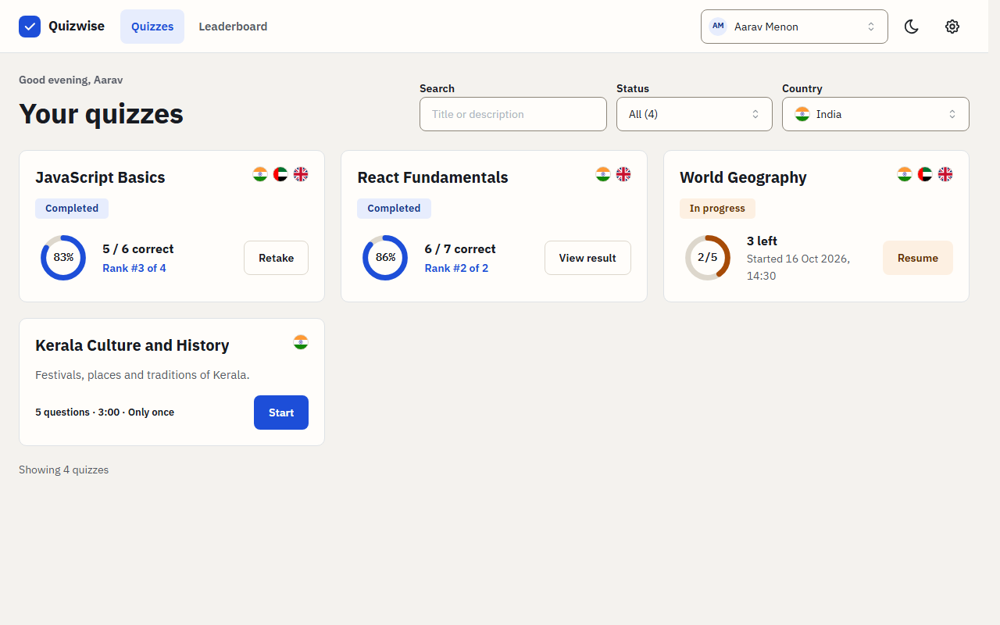       | 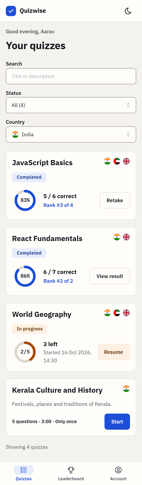       |
| Start screen   | 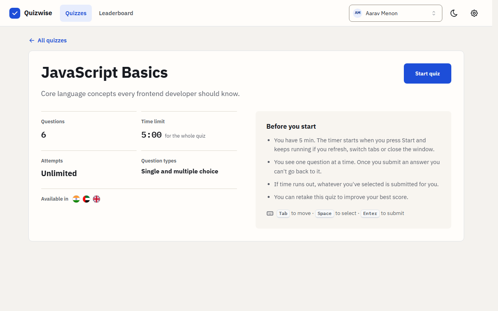        | 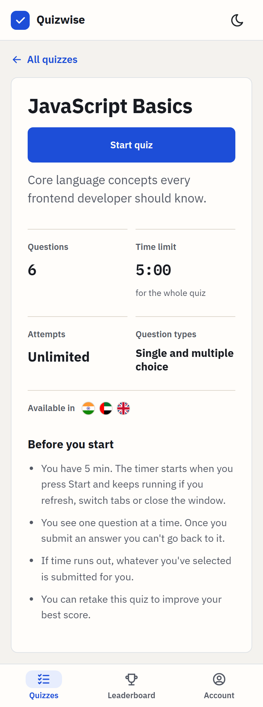        |
| Question       | 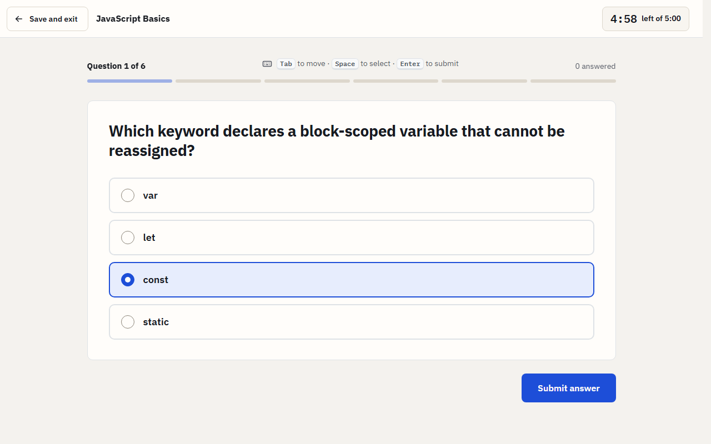         | 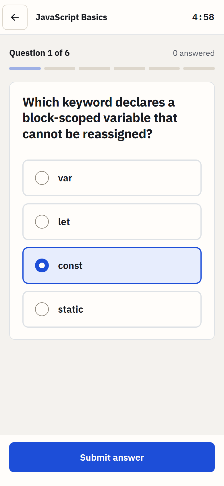         |
| Results        | 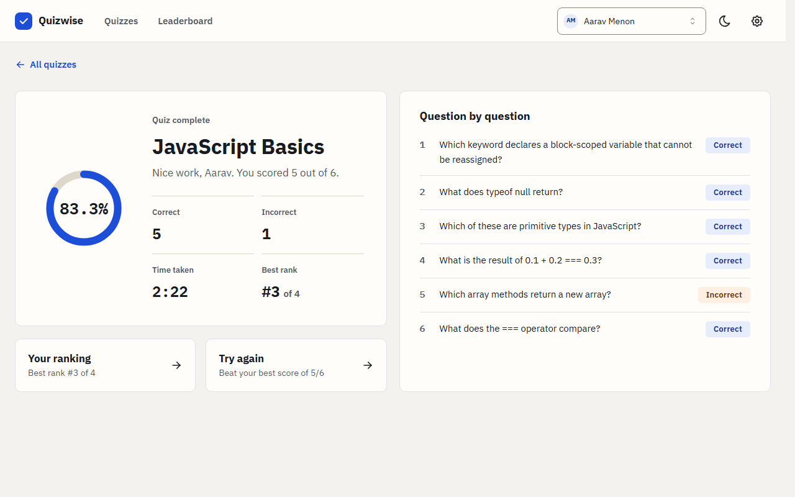           | 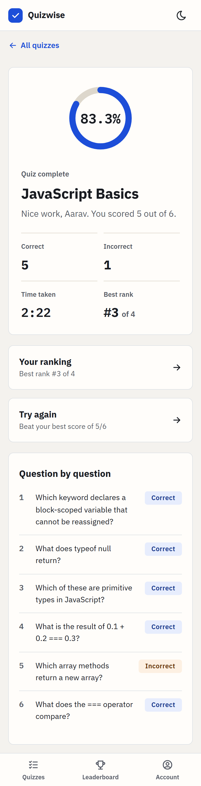           |
| Leaderboard    | 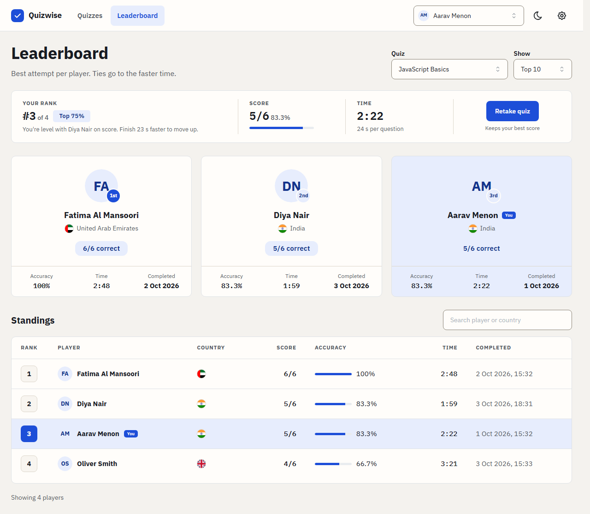   | 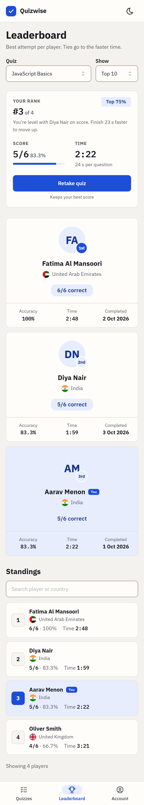   |
| Manage quizzes | 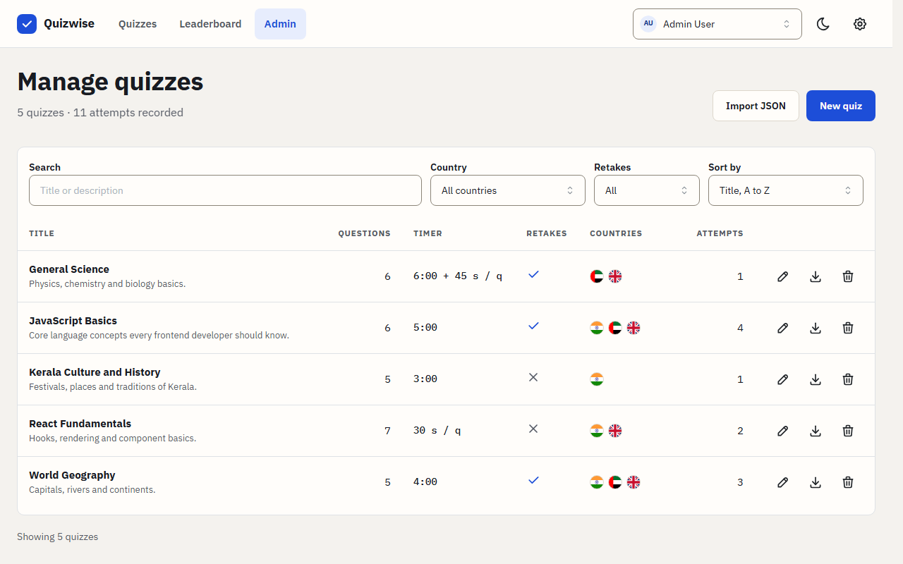 | 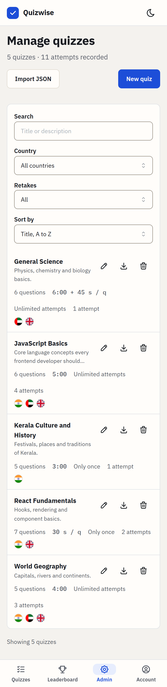 |
| Edit quiz      | 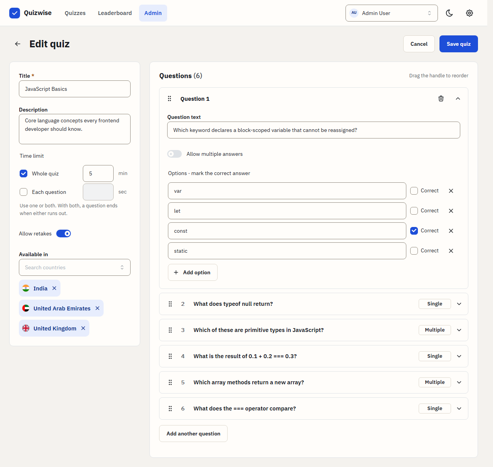      | 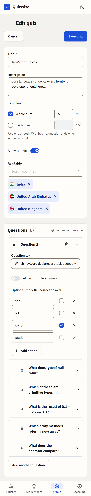      |

Dark mode, with warm charcoal surfaces and the same blue and orange:

| Step        | Desktop                                                                                           | Phone                                                                                            |
| ----------- | ------------------------------------------------------------------------------------------------- | ------------------------------------------------------------------------------------------------ |
| Quiz list   | 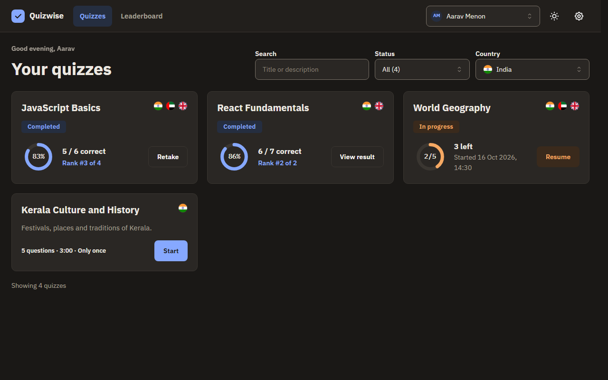     | 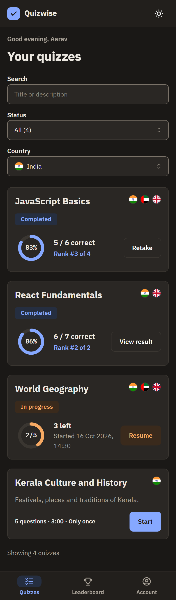     |
| Leaderboard | 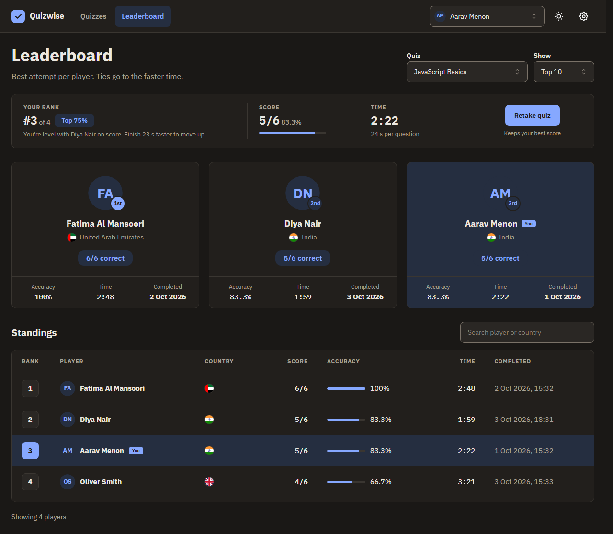 | 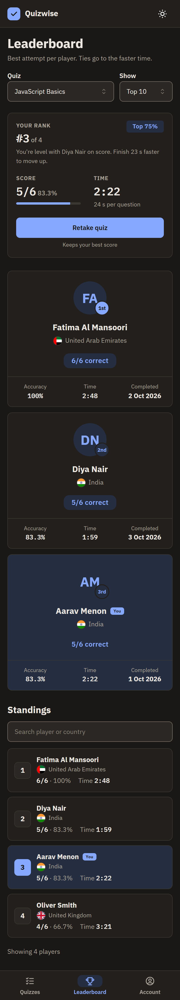 |
| Question    | 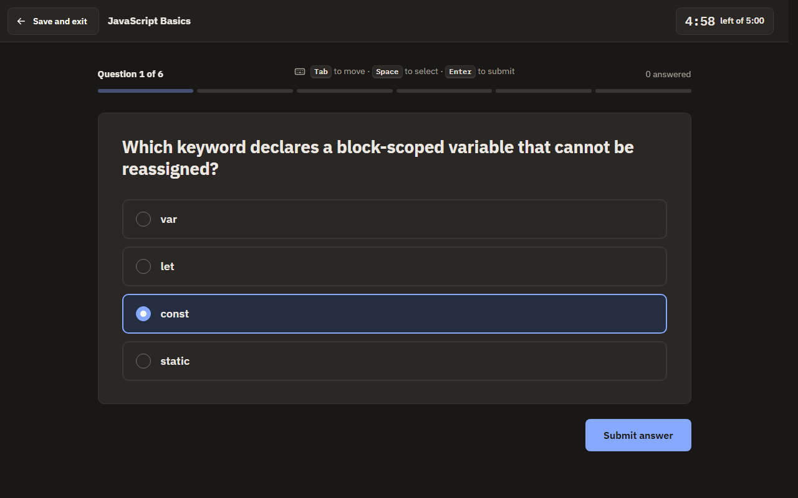       | 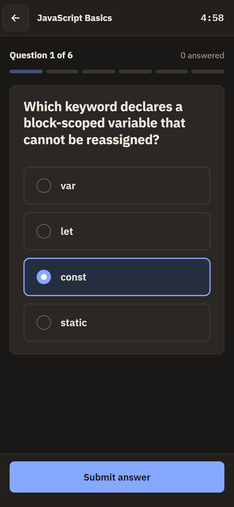       |

## Setup

You need Node 22.12 or later (`.nvmrc` pins 24).

```bash
npm install
npm run dev          # http://localhost:5173
npm run build        # type check and production build
npm run preview      # serve the production build
npm run lint         # ESLint
npm run typecheck    # TypeScript
npm run format       # Prettier
npm test             # unit and component tests (Vitest)
npm run test:coverage  # the same tests with a coverage report (HTML in coverage/)
npm run test:e2e     # end-to-end test (Playwright, starts its own dev server)
```

The end-to-end test needs a Playwright browser once: `npx playwright install chromium`. `npm install` also sets up the Git hooks (see Development workflow).

## Testing

- **Service unit tests.** They cover scoring (all-or-nothing multiple choice), deadlines for overall, per-question and combined limits, catching up on missed deadlines, ranking and the seed's tricky cases: the long-expired attempt a11 finishing as a timeout, tie-breaks by time on q1 and q3, quizzes without retakes, and the country filter hiding q2 and q4 from a user in the UAE.
- **Hook tests.** They check the countdown with fake timers, including a hidden tab and the expiry firing only once.
- **Component tests.** Written with Testing Library and queried by role and label, they cover answering, auto-submit on timeout, resume after a reload, the results page, the leaderboard, the admin form and its validation, routing and focus.
- **End-to-end test.** One Playwright test picks a user, takes a quiz from start to finish, and checks the result and the leaderboard.

Coverage, from `npm run test:coverage` (357 tests across 93 source files):

| Area       | Lines     | Branches | Functions |
| ---------- | --------- | -------- | --------- |
| Overall    | **96.6%** | **88%**  | **95.7%** |
| service    | 100%      | 86.7%    | 100%      |
| session    | 100%      | 100%     | 100%      |
| data       | 99.1%     | 94.0%    | 97.6%     |
| components | 96.5%     | 92.6%    | 95.1%     |
| hooks      | 95.8%     | 81.4%    | 92.0%     |
| pages      | 94.0%     | 85.5%    | 95.6%     |
| app        | 82.6%     | 83.3%    | 87.5%     |

The lowest files are `App.tsx`, which only mounts the router and is covered by the end-to-end test instead, the route error screen, and the development-only Load test data button.

Coverage only shows that code ran, not that a test would notice it breaking. To check that, I broke 11 core rules on purpose, one at a time (scoring, deadlines, tie-breaks, the country filter, retakes, double answers, closing attempts after an edit, the disabled Submit button and others) and ran the suite. The tests caught 10; the one that slipped through (a multiple choice answer with one correct option swapped for a wrong one) now has its own test.

## Data

On first load the seed (`src/data/seed.json`) is migrated and copied to localStorage under `quizwise:v1`. Every change after that is saved there, so a reload keeps it. If the stored data fails the schema (edited by hand or an old shape), the app falls back to the seed. Open tabs stay in sync: when one tab saves, the others reload the data through the browser's `storage` event, so a tab never writes back stale data and lists update without a reload. The selected user stays per tab.

The selected user, the country filter and the slow network switch are saved separately under `quizwise:session`. They are checked when they load too, and a value with the wrong shape goes back to its default. Mantine remembers the colour scheme.

Reset data (in Settings, or the Account sheet on phones) restores the seed after a confirmation. In development builds, Load test data adds 45 quizzes, 45 users and their attempts, to try pagination and search with long lists.

## Architecture

```
components and pages  ->  hooks  ->  quizService  ->  data store (Zustand vanilla + persist)  ->  localStorage
                                          |
                                 scoring.ts, timing.ts (pure functions)
```

- `quizService` is the only code that touches the data store. ESLint rules stop pages, components and hooks from importing the store, and stop pages and components from calling the service directly: they go through hooks.
- During an attempt the service returns questions without `correctOptionIds`, so the UI never has the correct answers before submitting.
- Hooks subscribe to the service's change events, so the quiz list and leaderboard update right after an attempt finishes.
- The service takes an injected clock and an optional simulated delay. Tests use a fake clock and no delay.
- A small separate Zustand store holds session state (current user, country filter, slow network).
- Scoring and timing are calculated in the service from stored timestamps, never from the UI's timer.

```
src/
  app/          entry point, providers, routes, theme
  pages/        one folder per page; admin pages are lazy loaded
  components/   one folder per component (index.tsx + types.ts)
  hooks/        data and behaviour hooks (attempt, countdown, leaderboard, ...)
  service/      quizService, attempts, ranking, scoring, timing, latency, types
  data/         seed, Zod schema, store and migration
  session/      session store
  types/        data models
  test/         test setup and render helper
  format.ts     date, time and duration formatting
  download.ts   saves an exported quiz as a file
e2e/            Playwright test
```

Libraries:

| Library                                                            | Why                                                               |
| ------------------------------------------------------------------ | ----------------------------------------------------------------- |
| React 19, Vite 7, TypeScript (strict)                              | Required by the brief. Vite 7 is the mature line                  |
| Mantine 9                                                          | Accessible components, forms, modals, notifications and dark mode |
| React Router 7                                                     | Deep links, lazy routes and `useBlocker` for unsaved changes      |
| Zustand 5                                                          | A small persisted store for data and one for the session          |
| Zod 4                                                              | One schema for the seed, the quiz form and imported JSON          |
| dnd-kit                                                            | Drag and drop question reordering with keyboard support           |
| Tabler icons, flag-icons, IBM Plex fonts                           | Icons, country flags and self-hosted fonts                        |
| Vitest, Testing Library, Playwright                                | Unit, component and end-to-end tests                              |
| Husky                                                              | Git hooks that run the checks before a commit and a push          |
| ESLint (typescript-eslint strict, react-hooks, jsx-a11y), Prettier | Linting and formatting                                            |

## Data models and service functions

The seed shapes are kept, with these additions:

- `Quiz.version`: starts at 1 and increases on every real change.
- `Attempt.quizVersion`: the quiz version when the attempt started.
- `Attempt.draftOptionIds`: the current selection, so it survives a reload and can be submitted on timeout.
- `Attempt.status` can also be `closed` (the quiz was edited or deleted during the attempt), and `Attempt.endReason` records why an attempt ended: `submitted`, `timeout`, `quiz_changed` or `quiz_deleted`.

Completed seed attempts keep their stored score and time. Several of them have an answer timestamp later than `completedAt`, so they are not recalculated.

All the functions from the brief are in `quizService`: `getQuizzes`, `getQuiz`, `createQuiz`, `updateQuiz`, `deleteQuiz`, `startOrResumeAttempt`, `getCurrentQuestion`, `submitAnswer`, `completeAttempt` and `getLeaderboard`. Changes from the brief's signatures:

- `getQuizzes(userId, countries?)` takes a list of country codes: `[]` for all countries, or leave it out for the user's own country.
- `getLeaderboard(quizId, limit, userId)` takes the user, so their rank is returned even outside the limit.
- Attempt methods take an optional `userId` and reject another user's attempt as not found.
- `submitAnswer` ignores an answer for a question that is no longer current, which stops double answers.
- `updateQuiz` only increases the version when something changed, and `deleteQuiz` also deletes the quiz's completed attempts.

Added functions: `saveDraft`, `getQuizSummary`, `getAttemptResult`, `getEndedAttempt`, `getAdminQuizzes`, `getQuizForEdit`, `exportQuiz`, `importQuiz`, `getUsers`, `getCountries`, `resetData`, `loadTestData` and `subscribe`.

## Assumptions

- The country filter defaults to the current user's country, and no selection means all countries.
- The admin section is for the seed's Admin User only. The Admin tab is hidden for other users and admin URLs show an "Admins only" message. There is no real login, so this follows the data model and is not security.
- The leaderboard shows each user's best attempt.
- An attempt whose quiz was edited is closed without a score and doesn't count as completed, so the user can start again even when retakes are off.
- The question breakdown on the results page is shown only if the quiz hasn't changed since the attempt.
- Submit answer is disabled until something is selected; only a timeout submits an empty answer, which counts as missed and incorrect.
- Percentages are rounded to one decimal place.
- A quiz must be available in at least one country and needs at least two options per question.
- Quiz text has length limits in the form and in imported JSON: 120 characters for a title, 500 for a description or question, 200 for an option.
- The app opens in light mode with a manual dark mode toggle, instead of following the system setting.

## Known limitations

- Everything lives in the browser. The UI never receives the correct answers during an attempt, but the full quiz data, answers included, is in localStorage, so anyone can read it in the browser's developer tools or make themselves admin by editing the stored user. The real fix is a backend that keeps the answers, scores attempts and checks roles on the server.
- An expired in-progress attempt still shows as in progress on the quiz list until it is opened, which is when the "time ran out while you were away" screen appears.
- New IDs come from `crypto.randomUUID`, which needs a secure context. Over plain HTTP (for example the dev server opened from a phone on the local network) starting an attempt, creating or importing a quiz, and adding a question or option fail. Over HTTPS, or on localhost, everything works.
- Users with exactly the same score and time are ranked by who finished first, not given a shared rank.

## What I would do with more time

- **Create quizzes from a prompt.** Instead of building a quiz by hand, the admin describes it: "A quiz about Kerala with easy and difficult questions, 10 questions, 10 minutes in total, 1 minute per question." An LLM asks for anything missing, such as the countries, generates the quiz in our schema, validates it with the same Zod schema and opens the edit form already filled in. The admin's job becomes reviewing and saving.
- **Image-based answer options.** The brief lists them as a bonus.
- **Localisation.** Translated UI text and dates formatted for each language.
- **A real backend and login.** The correct answers would stay on the server, attempts are scored there, roles are enforced and results are shared between devices. This removes the biggest known limitation, and the service layer is already the single point to swap.
- **Insights for admins.** A dashboard per quiz showing:
  - which questions are missed most often and how long each one takes, to spot unclear or too easy questions
  - which wrong option is picked most, which points to a misleading option or a wrong answer key
  - questions that the top scorers mostly get wrong, a strong sign of a wrong answer key
  - how often attempts end in a timeout, per quiz and per question, to tell whether a time limit is too tight
  - where users drop off: started but never finished, or saved and never came back
  - the score spread (average, median, distribution), not only the leaderboard's top
  - how much users improve between their first and best attempt on quizzes with retakes
  - participation and scores by country, and attempts over time
  - how scores changed after an edit, and how many attempts were closed by it
- **Explanations on the results page.** An optional note per question explaining the correct answer, shown only when the user can't retake the quiz (retakes off, or no attempts left). On quizzes with retakes, showing answers would let users look them up and retry for a full score.
- **A question bank with random order.** Retakes wouldn't show the same questions in the same order.
- **Scheduled quizzes.** Open and close dates for each quiz.
- **Close expired attempts on the quiz list.** An attempt whose time ran out while the user was away would show as finished straight away instead of in progress.
- **Shared ranks.** Users with exactly the same score and time would share a rank.
- **More end-to-end tests.** A phone viewport, the timeout path and the admin flow, run on every pull request.

## Development workflow

- **Plan first.** I treated the assignment brief as the requirements document and turned it into a detailed plan before writing any code: the product decisions and assumptions, what's out of scope, the architecture, the folder structure, the data model changes, the library versions and the coding standards. The commits were listed up front as small steps, and steps found along the way (fixes and polish from browser testing) were added to the list as their own commits. The working plan was kept out of the repository; `CLAUDE.md` holds the rules that came from it.
- **Rules and guard rails for the agent.** The coding standards (naming, folder per component, no comments, styling rules, file size limits) are written in `CLAUDE.md`, and Claude Code hooks in `.claude/hooks` enforce the important ones: Git commands are blocked so I do all Git work, Prettier runs after every file write, and writes containing banned characters or comments are flagged. This kept the agent inside the agreed structure instead of improvising.
- **Small steps, each reviewed.** Work was split into small pieces. For each one the agent explained the approach first, then wrote the code; I reviewed it, checked it in the browser on a phone width and on desktop, and only then committed. Lint, type check, unit tests and the build had to pass before every commit. This is why the history has so many commits: each one is a single, reviewable change, and bugs found later were fixed in their own commits instead of being folded into other work.
- **Reviews per phase.** At the end of each phase, separate Claude Code review agents reviewed the phase's changes, and I decided which findings to fix as their own commits.
- **Git hooks, added at the end.** During development the rules were enforced by the Claude Code hooks, and lint, type check, unit tests and the build were run at the end of every step before committing. I added the Husky hooks in `.husky` last, so they wouldn't slow down the fast commit and push cycle while building. From now on they make the checks automatic for anyone working on the project, me included: pre-commit checks the formatting of the changed files and runs ESLint on the project, and pre-push runs the type check, the unit tests and the build. A commit or push that breaks the rules or fails the tests is stopped, unless someone deliberately skips the hooks with `--no-verify`. GitHub Actions is the backstop for that.
- **Continuous deployment.** Every push and pull request to `main` runs lint, the type check, the tests with coverage and the build in GitHub Actions (`.github/workflows/deploy.yml`), and the coverage report is kept as a downloadable artifact. Pushes to `main` that pass are deployed to Cloudflare Workers as static assets, with deep links falling back to `index.html` (`wrangler.jsonc`).
- **Security review.** As the final step, a security audit of the whole codebase and its dependencies was run (untrusted input, imported JSON, stored data, rendering, `npm audit`). Its findings were fixed as their own commits: the stored session is now validated when it loads, and quiz text has length limits. The deployed site also sends security headers (`public/_headers`): a Content Security Policy that only allows the site's own scripts, fonts and images, plus `nosniff`, a referrer policy, no framing and a permissions policy.
- **Coverage check.** At the end, test coverage was measured with Vitest's V8 coverage to find untested code. The results are in the Testing section.
- **Requirements check.** At the end, a separate agent went through the assignment brief requirement by requirement and looked for the code behind each one, to make sure nothing was missed.

## AI usage

- **Design.** The mockups were made with Claude (claude.ai) and Google Stitch.
- **Planning and code.** Claude Code was my pair programmer. It helped write the plan and wrote most of the code, the tests and this README, working through the plan one step at a time.
- **My part.** I set the requirements and the coding standards, made the product and design decisions, reviewed every step, tested the app in the browser on phone and desktop, reported the bugs and layout issues to fix, and did all the Git work.
